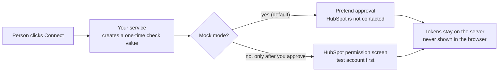

# HubSpot OAuth Service AI Starter

OAuth is the screen where someone allows an app to use their HubSpot account.
This starter teaches the steps behind that screen: connect, keep the connection
fresh, and disconnect. You start with a pretend connection on your own computer,
with an AI assistant that follows written safety rules.

> [!WARNING]
> **This is a learning starter, not finished software.** It is not
> security-audited, not made or endorsed by HubSpot, and has no warranty or
> support promise. It keeps everything in memory and must not be put online as
> it is. Practice with the pretend connection or a free HubSpot developer test
> account. You are responsible for what you build. See the [disclaimer](#disclaimer).

## What You Get

- A small working example of the whole connect, refresh and disconnect cycle,
  using a pretend HubSpot account.
- Rules for your AI assistant ([AGENTS.md](AGENTS.md)): what it must never do, and
  when it must ask you first.
- A path from practice, to a test account, to a checklist before anything real.

Do you need this starter at all? Only if other accounts will install your app.
For a tool used in one account, a simpler sign-in option is often enough: see
[which starter you need](docs/choose-your-path.md).

## Pick Your Path

| You are | Start here | You will have |
| --- | --- | --- |
| New to coding | [Step-by-step walkthrough](docs/start-here.md) | The pretend connection working on your computer and a plan for what your feature needs |
| Building with an AI assistant | [The first prompt to paste](START_WITH_AI.md) | An assistant that explains each step and asks before risky ones |
| A developer | [The flow](docs/oauth-flow.md), [installation contract](docs/contracts/oauth-installation-contract.md), [example](examples/minimal-oauth-service/README.md) | The route map, state and token handling, and tests |

A word you do not know? See the [glossary](docs/glossary.md).

## Try It

You need [Node.js](https://nodejs.org/en/download) 22 or newer and a terminal.
You do **not** need a HubSpot account, a password or key, or any package install.

1. On GitHub choose **Code > Download ZIP**, extract it, and open a terminal in
   the folder that contains `README.md`.
2. Run these two commands (in Windows PowerShell type `npm.cmd` instead of `npm`):

   ```bash
   npm run doctor
   npm run smoke:example
   ```

3. You are done when the last line says `oauth smoke example passed.`
4. Optional, to see it in your browser: run `node examples/minimal-oauth-service/server.js`,
   open `http://127.0.0.1:3000/oauth/start`, and you should see
   `{"connected":true,"mock":true}`. Press Ctrl+C in the terminal to stop it.

**What just happened:** a small program on your computer walked through a pretend
connection to a pretend account, then stopped itself. Nothing was sent to
HubSpot and no real account was connected. If a command fails, stop and read
[troubleshooting](docs/troubleshooting.md). Never switch off a check or type in
real credentials to make it pass.

## What To Do Next

1. **Change one small thing:** the [worked exercise](docs/worked-example.md).
2. **Understand the steps:** [the OAuth flow](docs/oauth-flow.md) in plain language.
3. **Understand accounts and sign-in choices:** the
   [connection guide](docs/connect-to-hubspot.md). Your assistant must ask you
   before it connects anything.
4. **Connect a free HubSpot developer test account, on your computer only:** the
   [first test with HubSpot](docs/first-live-test.md) checklist.
5. **Before real customers or real data:** the
   [live-use checklist](REAL_TOOL_CHECKLIST.md). That is a separate decision.

## How This Fits With HubSpot's Own Tools

HubSpot's official material creates and explains real apps: see the
[Build with AI quickstart](https://developers.hubspot.com/docs/build-with-ai/quickstart),
the [OAuth guide](https://developers.hubspot.com/docs/apps/developer-platform/build-apps/authentication/oauth/working-with-oauth)
and the official [OAuth quickstart sample](https://github.com/HubSpot/oauth-quickstart-nodejs).
This starter covers what comes before and around them: practice with a pretend
account, rules for your AI assistant, and a checklist before going live. It does
not replace the official tools or documentation.



## Safety Rules In Short

1. Keep passwords, keys, tokens and customer data out of AI chats, GitHub,
   screenshots and logs. Tokens belong on the server side, never in a browser.
2. Start with the pretend connection. Approve the exact account, permissions and
   action before anything touches a real HubSpot account.

More: [security in plain English](docs/security-for-non-developers.md) and
[the approval steps](docs/non-developer-safety-gates.md).

## For Developers

Run `npm run check:ai`, `npm run check`, `npm test` and `npm run smoke:example`;
no packages are needed. [EVIDENCE.md](EVIDENCE.md) records what was and was not
tested. Reference: [compatibility](COMPATIBILITY.md),
[authentication](docs/auth-options.md), [hosting](docs/hosting-options.md),
[idea recipes](recipes/README.md), [migration notes](MIGRATION.md) and
[upgrade notes](UPGRADE_NOTES.md).

## Disclaimer

- **No warranty.** Provided "as is" under the [MIT License](LICENSE), which
  disclaims warranties and limits the authors' liability. Keep the copyright
  and license notice when you reuse the code.
- **A starter, not a product.** The examples are not production-ready, not
  security-audited, and not verified in a live HubSpot account. A passing test
  here does not prove that what you build is secure.
- **You are responsible for what you build:** testing, security, privacy, legal
  compliance, costs and your customers' data. See
  [implementation responsibility](docs/implementation-responsibility.md).
- **Independent project.** Not affiliated with, endorsed by or supported by
  HubSpot. HubSpot is a trademark of HubSpot, Inc.
- **Not professional advice.** Nothing here is legal, security or compliance
  advice. HubSpot's platform changes, so check the current official documentation.

Help is best-effort with no response-time promise: see [support](SUPPORT.md).
Report security problems privately through [SECURITY.md](SECURITY.md).
